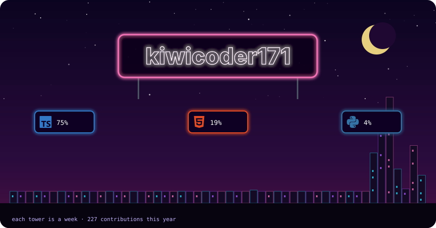
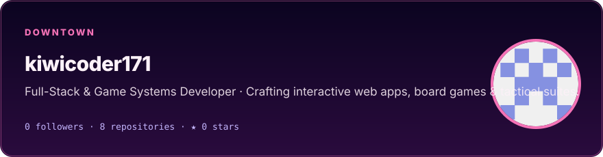
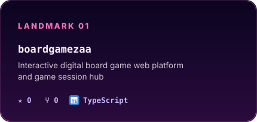
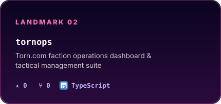
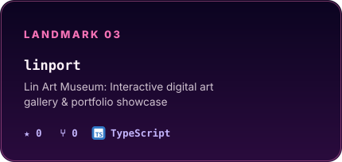
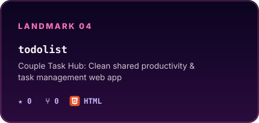

<picture>
  <source media="(prefers-color-scheme: light)" srcset="./assets/pixel-studio-light.svg" />
  
</picture>

The monitor scrolls live project commits · coffee is brewing · a cat guards the build.

  

<picture>
  <source media="(prefers-color-scheme: light)" srcset="./assets/neon-skyline-light.svg" />
  
</picture>

 

<picture>
  <source media="(prefers-color-scheme: light)" srcset="./assets/neon-about-light.svg" />
  
</picture>

---

### 🕹️ Featured Landmarks

  <a href="https://github.com/kiwicoder171/boardgamezaa">
    <picture>
      <source media="(prefers-color-scheme: light)" srcset="./assets/card-boardgamezaa-light.svg" />
      
    </picture>
  </a>
  <a href="https://github.com/kiwicoder171/tornops">
    <picture>
      <source media="(prefers-color-scheme: light)" srcset="./assets/card-tornops-light.svg" />
      
    </picture>
  </a>

  <a href="https://github.com/kiwicoder171/linport">
    <picture>
      <source media="(prefers-color-scheme: light)" srcset="./assets/card-linport-light.svg" />
      
    </picture>
  </a>
  <a href="https://github.com/kiwicoder171/todolist">
    <picture>
      <source media="(prefers-color-scheme: light)" srcset="./assets/card-todolist-light.svg" />
      
    </picture>
  </a>

---

### ⚡ Language Billboards & Stack

<picture>
  <source media="(prefers-color-scheme: light)" srcset="./assets/neon-stack-light.svg" />
  
</picture>

---

### 📡 Nightlife Telemetry & Momentum

<picture>
  <source media="(prefers-color-scheme: light)" srcset="./assets/neon-log-light.svg" />
  
</picture>

